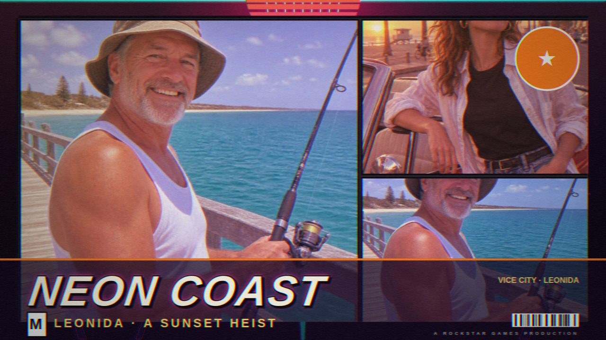
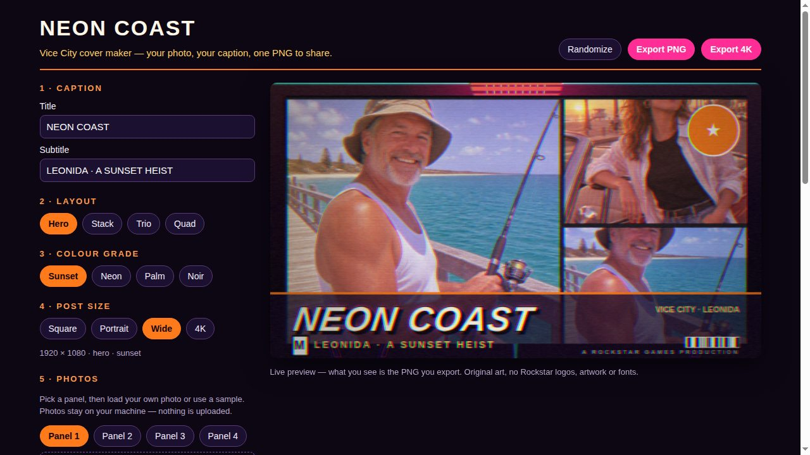
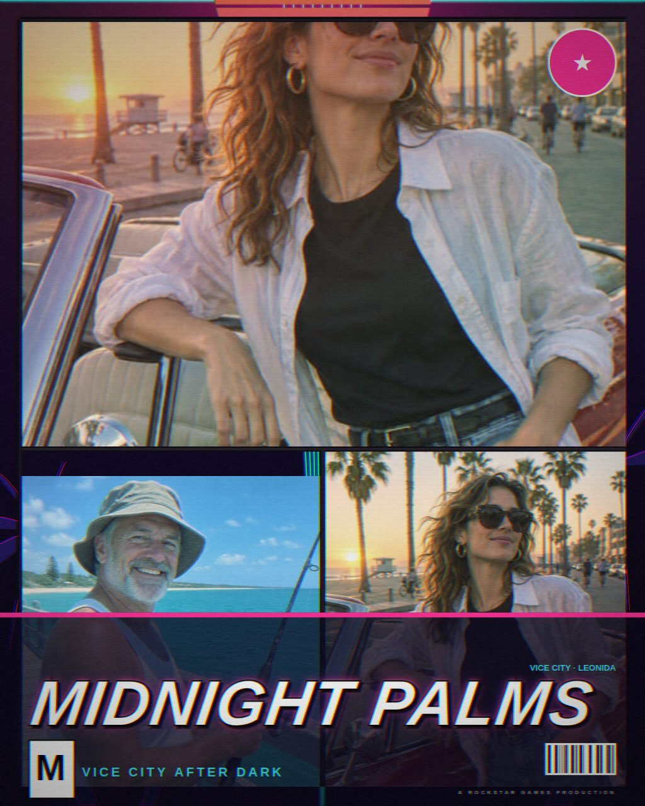
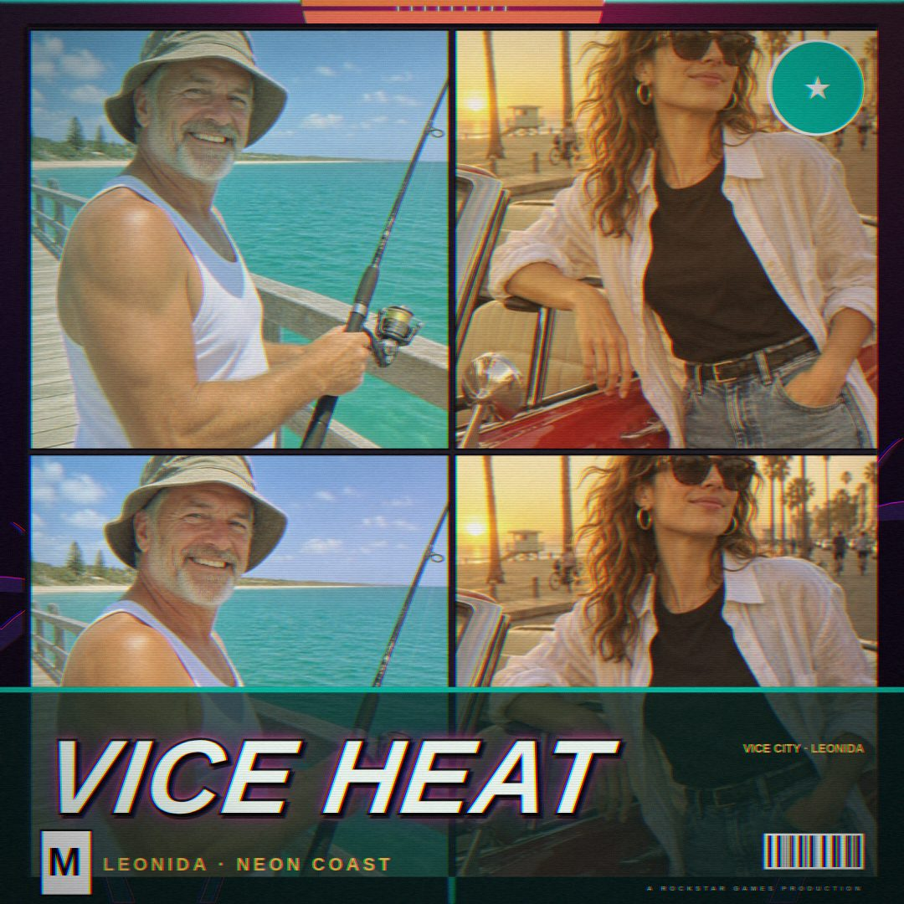
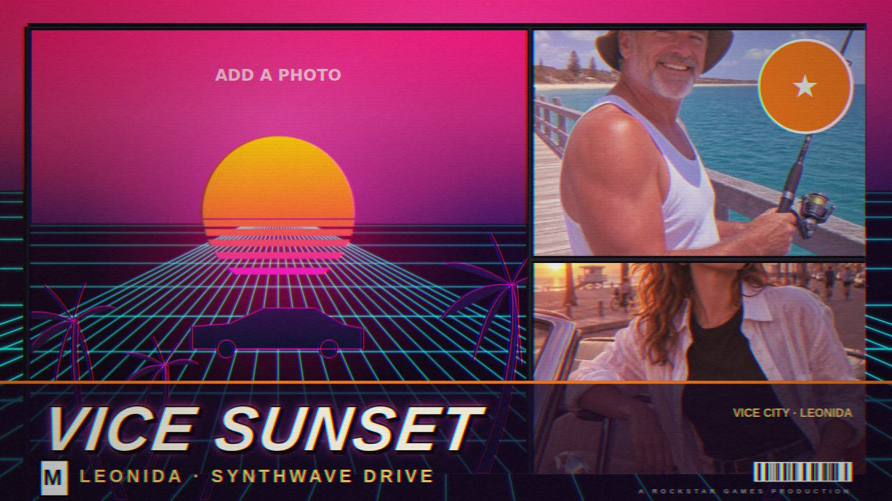
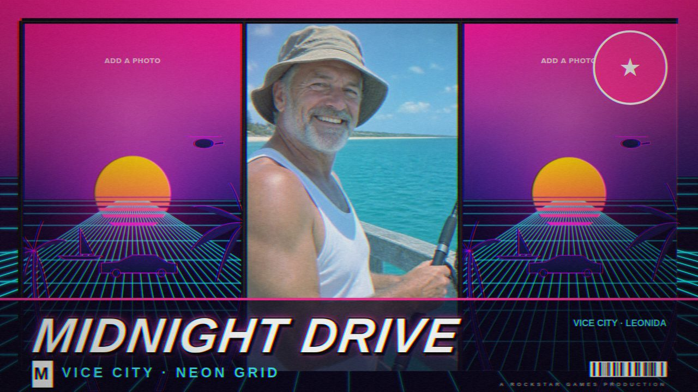
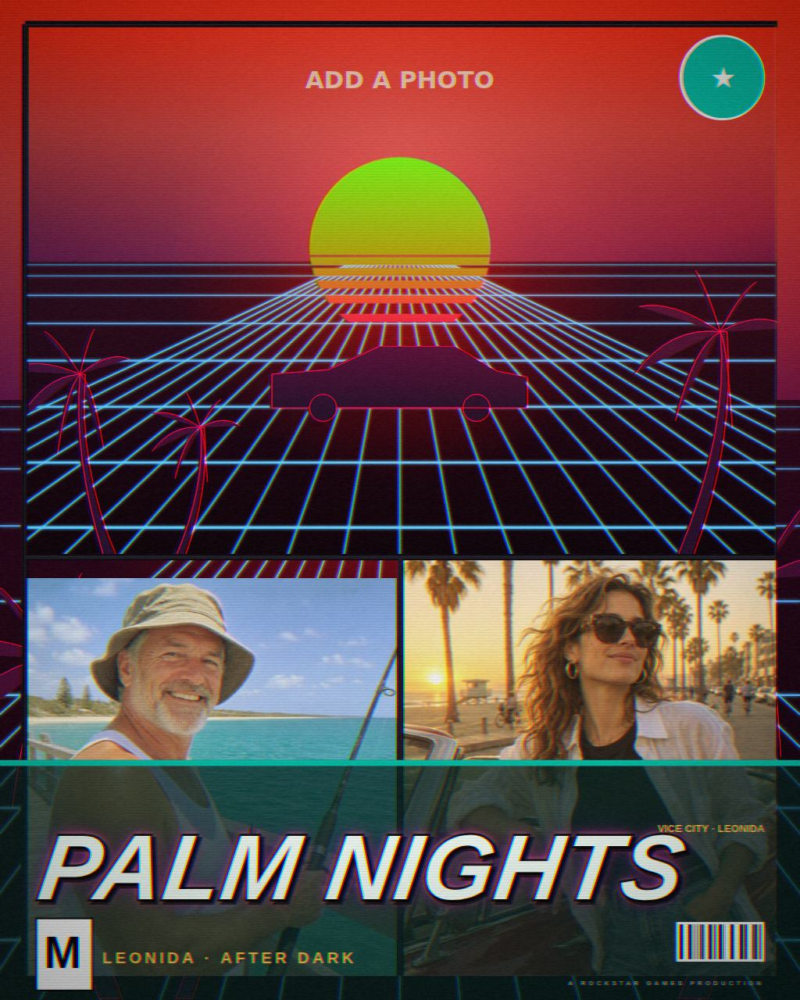
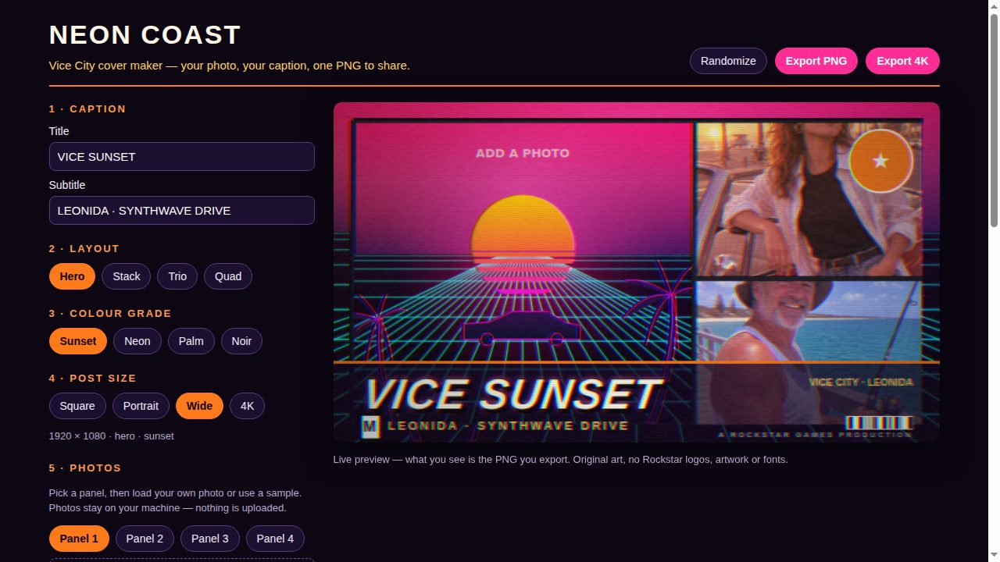

[](https://make.fun/competitions/gta6-cover-art-01) [](https://make.fun/competitions/gta6-cover-art-01) [](https://make.fun/competitions/gta6-cover-art-01)

# Neon Coast — Vice City Cover Maker

Turn any photo and a caption into GTA 6-style multi-panel cover art, in the
browser, offline. Photos stay on your machine — nothing is uploaded.

Made for the [gta6-cover-art-01 bounty](https://make.fun/bounty/gta6-cover-art-01) on [make.fun](https://make.fun).

## Covers it makes

| | | |
|---|---|---|
|  |  |  |
|  |  |  |
|  |  | |

## What it does

- **Multi-panel covers**: four layouts (Hero, Stack, Trio, Quad) that fill
  3–4 panels with one photo or several.
- **Any photo**: load your own photo per panel, or use the two bundled
  samples. Zoom and pan each panel to crop it just right.
- **Caption lettering**: a bold condensed title plus a neon subtitle, with a
  star badge and a "Vice City · Leonida" tag line. All lettering is original
  system-font type — no Rockstar logos, artwork or fonts.
- **Synthwave scene**: a neon gradient sky (hot pink `#FF007F` up top to
  deep purple `#2B1055` at the horizon), a scanline-cut sun (`#FFD700` to
  `#FF00FF`), a cyan `#00FFFF` perspective grid, and palm-tree / retro
  sports-car / helicopter / yacht silhouettes in a deep-purple-to-deep-blue
  gradient with a 1px hot-pink edge. The scene fills empty panels and
  frames the whole cover. Sliders move the sun, grid density, perspective
  depth and hue; **Randomize** shuffles the whole look.
- **Retro post**: CRT scanlines (one 10%-black line every 2px), chromatic
  aberration (red −2px, blue +2px), 5% film grain, neon glow in Screen
  blend, plus a vignette.
- **GTA-style lettering**: bold italic condensed title with a hard black
  drop shadow and three stacked glows (5px white, 15px neon pink, 30px
  deep purple).
- **Packaging details**: an ESRB-style rating box (`M`) bottom-left, a
  generated barcode bottom-right, and an "A Rockstar Games Production"
  credit line.
- **One-step export**: PNG in the common post sizes — 1080 × 1080,
  1080 × 1350 and 1920 × 1080 — plus **Export 4K** (3840 × 2160).

## Try it

```sh
node serve.ts
# open http://localhost:8080
```

Pick a layout and a grade, type a title, load photos, and hit **Export PNG**.

## How to swap in a custom font

The title is drawn on canvas, so a custom font needs two steps:

1. Add the font file to `app/` (for example `app/fonts/MyFont.woff2`) and
   declare it in `app/style.css`:
   ```css
   @font-face {
     font-family: "MyFont";
     src: url("fonts/MyFont.woff2") format("woff2");
   }
   ```
2. Point the canvas at it in `app/src/render.js` — edit `titleFont` inside
   `drawTitleBlock` (and the matching `ctx.font` lines) to put `"MyFont"`
   first in the stack, e.g.
   `italic 900 ${s}px "MyFont", "Arial Black", Impact, sans-serif`.
   Reload the page once so the font is registered before the first draw.

Use a bold condensed or brush/handwritten display face for the Vice City
look. The bundled default is a system-font stack (Arial Black / Impact) —
no Rockstar fonts are included or required.

## How to import a custom foreground PNG

In the editor, section **7 · Synthwave scene**, use **Import a custom
foreground PNG**: pick a PNG with a transparent background (a car, a palm,
a skyline — any silhouette cut-out). It is drawn over the synthwave ground,
centred and bottom-aligned, in every empty panel and in the cover frame,
and it follows the hue-shift slider. **Remove custom foreground** clears
it. The file never leaves your machine: it is read as a data URL and drawn
straight onto the canvas.

## How it is built

- `app/index.html` + `app/style.css` — the editor shell and studio UI.
- `app/src/render.js` — the cover engine: panel layouts, photo cover-fit,
  grade washes, the synthwave scene (sky, sun, grid, silhouettes), title
  block, ESRB + barcode packaging, CRT scanlines, chromatic aberration,
  grain and vignette on a 2D canvas.
- `app/src/editor.js` — controls, photo loading, scene sliders, Randomize,
  live preview, PNG / 4K export, custom foreground import.
- `app/src/capture.js` — `?shot=cover` / `?shot=editor` screenshot mode.
- `main.ts` — the entrypoint: copies `app/` and `screenshots/` to the
  output directory and writes `dossier.json` with the kit's `buildDossier`.

## Verify

```sh
mkdir -p out && MAKEFUN_OUTPUT_DIR=out node main.ts
```

## License

MIT — see `LICENSE`.
